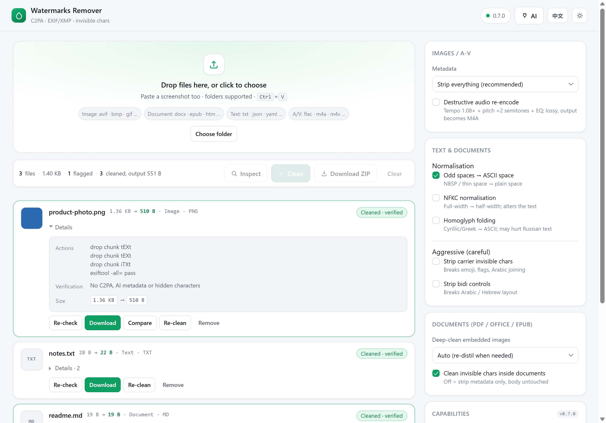

# CleanMarks

**English** · [简体中文](README.zh-CN.md)

A self-hosted web UI for the **[watermarks-remover](https://github.com/guillaumemeyer/watermarks-remover)**
cleaning engine: strip C2PA / EXIF / XMP / generator metadata and invisible Unicode from images,
documents, audio and video — locally, in Docker.

> Not a fork. This is a UI + proxy + compose layer on top of the official image
> `ghcr.io/guillaumemeyer/watermarks-remover` (MIT). The engine source is not vendored here
> (no keys, no telemetry) — but the published Docker Hub image ships it, so one `docker run` works.



*Bilingual UI — the `EN` button in the header switches language; screenshots show English.*

[](https://hub.docker.com/r/indexmobius/cleanmarks)  
[](https://github.com/MobiusIndex/cleanmarks/actions/workflows/docker-publish.yml)  

```sh
git clone https://github.com/MobiusIndex/cleanmarks && cd cleanmarks
docker compose up -d --build      # first run pulls the engine image (~1 GB)
```

Open <http://127.0.0.1:8770>. Docker 24+ / Compose v2, ~3 GB disk.

Or skip the build entirely — the image is on Docker Hub (engine included, one container):

```sh
docker run -d --name cleanmarks -p 127.0.0.1:8770:8770   --tmpfs /tmp:rw,size=512m indexmobius/cleanmarks:latest
```

Prefer one container? `docker compose -f compose.allinone.yaml up -d --build` — engine and UI in the
same container. Port, bind address and limits live in `.env` (`cp .env.example .env`).

## Features

- Drag & drop, click, paste, or pick a whole folder; batch with cancel
- Inspect first (read-only report), then clean — with an automatic verification pass
- Before/after compare for images, ZIP download built in the browser
- Removes C2PA / EXIF / XMP / generator metadata; cleans zero-width chars, bidi controls, homoglyphs
- Optional: LLM text rewriting (Layer B) · optional destructive audio re-encode
- Light/dark, Chinese/English, all preferences remembered locally

**Not included** (the UI says so rather than pretending): pixel-level watermarks (SynthID, Tree-Ring),
text-watermark detection (MarkLLM / Gumbel / Claude), and anything that helps dodge compliance rules.

**Formats** — images `png jpg webp avif heic gif bmp tiff`; documents `pdf docx xlsx pptx odt epub svg
html md`; text (59 types incl. `txt json yaml py js ts go rs`); audio/video `mp4 mov m4a wav mp3 flac`.
Extension-less files are sniffed by magic bytes.

## Documentation

- [Options & configuration](docs/details.md#options) — every switch, every env var
- [Architecture & HTTP endpoints](docs/details.md#architecture)
- [AI interface (Layer B)](docs/details.md#ai-interface-layer-b-text-rewriting) — 16 provider presets
- [Portability](docs/details.md#portability-notes) · [Offline install](docs/details.md#offline-install)
- [Development & tests](docs/details.md#development-and-tests) — 116 assertions
- [FAQ](docs/details.md#faq) · [LAN sharing](docs/details.md#sharing-on-a-lan)

## Licence

Engine © [guillaumemeyer/watermarks-remover](https://github.com/guillaumemeyer/watermarks-remover) (MIT).
This repository's own code is **MIT** — see [LICENSE](LICENSE). Use it only on content you own or are
allowed to process.
