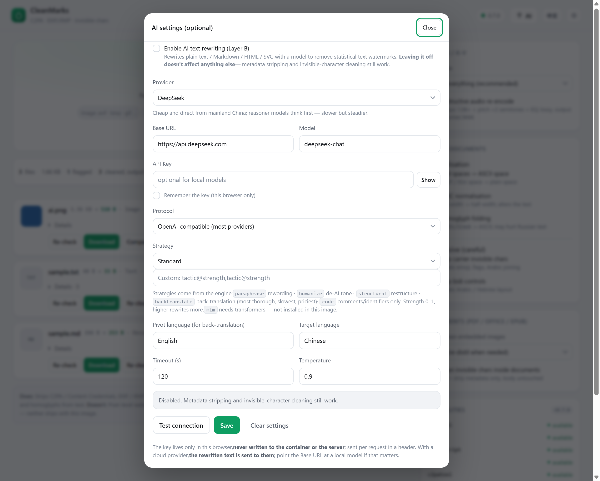

# 细节文档

**[CleanMarks](../README.zh-CN.md)** 的扩展文档 · [English](details.md)

安装和日常使用看 [README](../README.zh-CN.md)；这里是可以查阅的细节。

## 目录

- [AI 接口（Layer B 文本改写）](#ai-接口layer-b-文本改写)
- [配置](#配置)
- [选项](#选项)
- [架构](#架构)
- [目录与文件](#目录与文件)
- [开发与自测](#开发与自测)
- [常见问题](#常见问题)
- [局域网共享](#局域网共享)
- [移植与适配](#移植与适配)
- [离线安装](#离线安装)
- [维护者备注：发布到 GitHub](#维护者备注发布到-github)

---

## AI 接口（Layer B 文本改写）



右上角「AI 接口」是**可选功能**。不配置的话，上面所有功能照常工作；配置之后，
纯文本 / Markdown / HTML / SVG 会额外做一次模型改写，用来抹掉 AI 文本的统计水印
（这是唯一能真正移除文本水印的路径）。

### 服务商预设

选服务商会自动填好 Base URL 与模型名，也可以选「自定义」填任意 OpenAI 兼容端点。

| 服务商 | Base URL | 模型示例 |
| --- | --- | --- |
| OpenAI | `https://api.openai.com` | gpt-4o-mini / gpt-4.1-mini |
| DeepSeek | `https://api.deepseek.com` | deepseek-chat / deepseek-reasoner |
| 月之暗面 Kimi | `https://api.moonshot.cn` | kimi-k2-turbo-preview |
| 智谱 GLM | `https://open.bigmodel.cn/api/paas/v4` | glm-4-flash / glm-4-plus |
| 阿里云百炼 Qwen | `https://dashscope.aliyuncs.com/compatible-mode/v1` | qwen-plus / qwen-max |
| 腾讯混元 | `https://api.hunyuan.cloud.tencent.com/v1` | hunyuan-turbos |
| 讯飞星火 | `https://spark-api-open.xf-yun.com/v1` | x1.5 / 4.0Ultra |
| 百度千帆 | `https://qianfan.baidubce.com/v2` | ernie-4.0-8k |
| 硅基流动 | `https://api.siliconflow.cn/v1` | Qwen/Qwen2.5-72B-Instruct |
| OpenRouter | `https://openrouter.ai/api/v1` | deepseek/deepseek-chat |
| Groq | `https://api.groq.com/openai/v1` | llama-3.3-70b-versatile |
| xAI Grok | `https://api.x.ai/v1` | grok-4 |
| Anthropic Claude | `https://api.anthropic.com/v1` | claude-sonnet-4-5 |
| Google Gemini | `https://generativelanguage.googleapis.com/v1beta/openai` | gemini-2.5-flash |
| Ollama（本地，需装在 WSL） | `http://host.docker.internal:11434` | qwen3:8b |
| LM Studio（装在 Windows 主机上） | `http://host.docker.internal:1234` | local-model |

Base URL 的路径会自动补全：结尾是 `/v1`、`/v2`、`/v3`、`/v4` 或 `/openai` 的补
`/chat/completions`，其余补 `/v1/chat/completions`。协议可选 OpenAI 兼容或 Ollama 原生。

### 改写策略

策略来自上游引擎，语法 `战术@强度` 逗号分隔，强度 0–1 越大改得越多：

| 战术 | 作用 |
| --- | --- |
| `paraphrase` | 换词改写，token 级改变措辞 |
| `humanize` | 去 AI 腔（句式、套话、装饰性副词） |
| `structural` | 先抽要点再重写成完整文档 |
| `backtranslate` | 回译，抹水印最彻底，也最慢最贵 |
| `code` | 只改注释、文档串和局部变量名 |
| `mlm` | 需要 transformers，本镜像没装，会直接报错 |

界面提供「轻度 / 标准 / 彻底 / 去 AI 腔 / 改写+去 AI 腔 / 结构重排 / 回译」预设，
也可以自己写。

### 密钥与隐私

- 密钥**只存在你这台机器的浏览器**（localStorage），不写进容器、不落服务端；每次请求
  随 `X-Wm-Llm` 头带过去，服务端用完即弃，错误信息里也会把密钥替换成 `***`。
- 用云端服务商时，**被改写的正文会发送给对方**。介意隐私就把 Base URL 指向本地模型。
- 「测试连接」发一个最小请求，返回延迟、模型名和实际命中的端点。

### 本地模型的网络拓扑

Docker 跑在 WSL 里时：

- 容器**没有** `host.docker.internal` 这个 DNS。填它也能用——服务端会自动改用容器的
  默认网关（也就是 WSL 宿主）地址。
- WSL 里的服务只要监听全网卡（Ollama 设 `OLLAMA_HOST=0.0.0.0`），容器就能直连。
- 只监听 `127.0.0.1` 的服务（Ollama 默认配置）用 `llm-relay.py` 在 WSL 里桥一道：

  ```sh
  # WSL 里执行
  python3 llm-relay.py --listen 8788 --target 11434
  # 界面 Base URL 填 http://host.docker.internal:8788/v1
  ```

- **Windows 上的 LM Studio 容器够不到**：WSL 与 Windows 不共享 loopback，容器也到不了
  Windows 主机上的局域网地址（通常不可达）。要本地跑请把模型服务装进 WSL，或用云端 API。

---

---

## 配置

### 本项目（wm-web）

| 变量 | 默认 | 说明 |
| --- | --- | --- |
| `WATERMARKS_UPSTREAM` | `http://wr-core:8765` | 引擎地址 |
| `WATERMARKS_SCRIPTS` | `/app/scripts` | 引擎脚本目录（复用其中的 text_unicode / rewrite_text） |
| `WATERMARKS_WEB_PORT` | `8770` | 监听端口（也可用 `--port`） |
| `WATERMARKS_MAX_INPUT_BYTES` | `268435456`（256MB） | 单文件上限 |
| `WATERMARKS_MAX_BATCH_FILES` | `50` | 批量上限 |
| `WATERMARKS_WEB_TIMEOUT` | `1800` | 转发引擎的超时（秒） |

### 引擎（wr-core，按需开启）

| 变量 | 作用 |
| --- | --- |
| `WATERMARKS_SERVER_API_KEY` | 引擎自身鉴权（留空即不鉴权） |
| `WATERMARKS_REWRITE_BACKEND` / `_MODEL` / `_BASE_URL` / `_API_KEY` | 引擎侧 Layer B 后端（用界面配置更方便，二选一） |
| `WATERMARKS_CLEAN_STRATEGY_FILE` | 默认策略文件（默认 `config/clean_strategy.json`） |
| `WATERMARKS_GUMBEL_KEY` | 启用 Gumbel 文本水印检测（免模型） |
| `MARKLLM_DIR` / `MARKDIFFUSION_DIR` / `NOAI_WATERMARK_DIR` / `REVERSE_SYNTHID_DIR` | 外部模型后端的检出目录 |


---

## 选项

| 选项 | 作用 | 默认 |
| --- | --- | --- |
| 元数据：全部 / 仅 AI 标记 | 全部剥离，或保留相机参数 | 全部剥离 |
| 音频破坏性重编码 | 变速 1.08× + 升调 2 半音，输出 M4A | 关 |
| 异体空格 → 普通空格 | NBSP、窄空格转普通空格 | 开 |
| NFKC 归一化 | 全角转半角（会改正文） | 关 |
| 同形字归正 | 西里尔/希腊字母转 ASCII | 关 |
| 剥离承载型不可见字符 | 连写符、变体选择符 | 关 |
| 剥离双向控制符 | RLO/LRO/PDF 等 | 关 |
| 内嵌图片深度清理 | PDF/Office 里的图片重蒸馏 | 自动 |
| 文档内文本也清理 | 关闭则只剥元数据 | 开 |

Markdown / HTML / SVG 这类「文本型容器」先走引擎的容器管线（剥 frontmatter 里的 AI 字段、
内嵌 data URI），再按上面的开关补一遍 Layer A 归一化——报告会分段列出。

---

## 架构

```
浏览器
  ↓ http://127.0.0.1:8770
wm-web            界面 + 转发层（Python 标准库，无第三方依赖）
  ↓ http://wr-core:8765（仅容器网络内，不映射宿主机端口）
wr-core           官方清洗引擎
                  exiftool / qpdf / ghostscript / ffmpeg / c2patool
```

转发层承担了三件引擎不做的事：

1. **二进制直传**：页面把文件当请求体发过来，服务端流式落盘、分块编码成引擎要的
   base64 JSON 信封；回来的 base64 也在服务端解码，浏览器只拿到 Blob + `X-Wm-Report`
   头。页面因此不做 base64，49MB 的图片全程约 8.6 秒，内存峰值在几十 MB 量级。
2. **按类型分流**：引擎对纯文本 `/clean` 强制要求 Layer B 重写后端（未配置时必然 400），
   这类文件改用引擎自带的 `text_unicode` 做 Layer A；其余交给引擎。无扩展名文件按魔数识别。
3. **能力下发**：`/api/meta` 一次给出引擎版本、工具可用性、选项白名单、大小限额，界面据此
   禁用不可用选项，而不是让用户点了才看到报错。

两个容器都设了 `restart: unless-stopped`，Docker 启动后自动拉起；`wr-core` 不映射宿主机
端口，只能经 `wm-web` 访问；`wm-web` 绑 `127.0.0.1`，外网访问不到。

### HTTP 端点

| 方法 | 路径 | 说明 |
| --- | --- | --- |
| GET | `/`、`/index.html`、`/app.js`、`/styles.css` | 静态页面 |
| GET | `/api/ping` | **只报 web 进程**活着（容器健康检查用它，引擎挂掉不跟着判死） |
| GET | `/api/health`、`/api/capabilities` | 透传引擎 |
| GET | `/api/meta` | 能力、选项白名单、限额（缓存 60s） |
| POST | `/api/raw/inspect` | 请求体是原始文件，返回检测 JSON |
| POST | `/api/raw/clean` | 请求体是原始文件，返回清理后的二进制 + `X-Wm-Report` 头 |
| POST | `/api/llm/test` | AI 接口探活（最小 chat 请求），返回延迟与实际端点 |
| POST | `/api/text-clean` | 旧版 JSON 接口（base64 进、base64 出），保留给脚本 |
| POST | `/api/clean`、`/api/inspect`、`/api/clean/batch` … | 透传引擎 |

`/api/raw/*` 把文件名与选项放在请求头：`X-Wm-Name`、`X-Wm-Options`（base64url JSON，
避免中文文件名与查询串长度问题）。配置了 AI 接口时再带 `X-Wm-Llm`（同样的编码），
只对文本类文件生效。

响应头：`X-Wm-Report`（base64 的报告 JSON）、`X-Wm-Out-Name`（建议的下载名）、
`X-Wm-Kind`、`X-Wm-Bytes-Out`。

---

---

## 目录与文件

| 文件 | 作用 |
| --- | --- |
| `compose.yaml` | 编排定义：两个服务、tmpfs、健康检查、只读 rootfs |
| `compose.allinone.yaml` | 单容器模式的编排（引擎与界面同容器） |
| `docker/entrypoint.sh` | 容器入口：需要时先拉起嵌入式引擎，再启动界面 |
| `Dockerfile` | 界面镜像，基于官方镜像，只加四个文件 |
| `server.py` | 界面服务 + 转发层（纯文本 Layer A、AI 接口、Layer B） |
| `index.html` | 页面骨架（无框架） |
| `styles.css` | 主题变量与组件样式（含深色模式） |
| `app.js` | 页面逻辑：批量并发、取消、复检、对比、ZIP、偏好、AI 接口配置 |
| `llm-relay.py` | 可选：把只监听 127.0.0.1 的本地模型服务桥给容器（在 WSL 里跑） |
| `start.sh` | Linux/macOS/WSL 启动脚本（`up` / `allinone` / `logs` / `stop` / `status` / `rebuild`） |
| `.env.example` | 端口、绑定地址、限额、并发的配置模板（复制成 `.env` 即可） |
| `LICENSE` | MIT |

运行时不会在宿主机写任何文件：容器 rootfs 只读，临时文件走 `/tmp`（tmpfs），随请求目录
一起删除。

---

---

## 开发与自测

源码改完，重建并重启：

```sh
docker compose up -d --build
```

如果编辑目录与运行目录是两个位置（例如 Docker 跑在 WSL 或虚拟机里），先把改动同步过去再重建。

回归脚本（开发者本地使用，不入库）：

| 脚本 | 覆盖 |
| --- | --- |
| `e2e.py` | 39 项：文本 / Markdown frontmatter / 图片 / DOCX / 音频链 / 视频 / 错误路径 / 旧接口兼容 |
| `e2e_llm.py` | 18 项：AI 接口探活、Layer B 生效、未配置时行为不变、密钥不外泄、非法配置报错 |
| `test_split.py` | 11 项：上游响应解析的边界（空内容、字段顺序变化、含引号的报告） |
| `test_edges.py` | 9 项：空文件、无扩展名文本、超长文件名、8 路并发一致性、并发下 /api/meta |
| `test_proto.py` | 11 项：短包被拒、错误响应的 Connection 语义、跨站 Origin、选项语义、存活探针、坏 LLM 头 |
| `test_units.py` | 28 项：报告头裁剪、主机回退判定、文件名清洗、文本兜底、格式判定（直接 import server.py） |
| `mock_openai.py` | 假 OpenAI 兼容服务端，供上面两个脚本使用 |

```sh
cd .ref && python e2e.py && python e2e_llm.py && python test_split.py \n  && python test_edges.py && python test_proto.py && python test_units.py
```

共 116 项断言：39（基础链路）+ 18（AI 接口）+ 11（响应解析）+ 9（边界并发）
+ 11（协议层）+ 28（纯函数单测）。

### 安全与健壮性边界

- **同源校验**：`POST` 带 `Origin` 且与 `Host` 不一致时回 403。服务只绑回环，但任意网页都能用
  `fetch` 直接打过来（CORS simple request 不需要预检），这条挡的是别的站点拿你的机器当算力。
- **短包拒绝**：`Content-Length` 声明 N 字节却少发时回 400，不会把半截文件当成完整输入清理。
- **错误即断开**：所有 4xx/5xx 响应带 `Connection: close`。错误分支通常没读完请求体，
  保持连接会让残留字节被当成下一个请求解析（日志里会出现 `"0123…GET /api/health" 501`）。
- **并发上限**：清理同时最多 2 个（`WATERMARKS_WEB_CONCURRENCY`），每个请求在 `/tmp`(tmpfs)
  上的峰值约 3.3–3.7 倍文件大小；检测 4 个。
- **密钥不出内网**：AI 接口的 host 回退（解析不到就试 docker 网关）只对 `localhost`、
  `host.docker.internal`、裸主机名、私网 IP 生效；云服务商域名解析失败只报错，不换地址重发，
  避免明文 http 下把 `Authorization` 送给别人。
- **上传/下载超时**：连接 120 秒无 I/O 即断开，慢速客户端不会无限期占住线程。
- **报告头有上限**：`X-Wm-Report` 打包后超过 12KB 会裁掉明细并带 `truncated: true`，
  免得代理把整条响应头丢掉。
- **ZIP 上限 4GB**：打包是手写的 store 模式 + 32 位偏移（没有 zip64），超过 4GB 会写出
  中央目录错位的坏包，所以直接拒绝并提示分批下载。
- **Layer B 探测定长缓存**：引擎配了重写后端时 `/api/meta` 的探测本身是一次真实 LLM 调用，
  结果缓存 30 分钟（未配置时 5 分钟）。

---

---

## 常见问题

| 现象 | 原因与处理 |
| --- | --- |
| 页面显示「引擎未连接」 | `wm-web` 连不上 `wr-core`：`docker compose logs wr-core` 看是否启动失败 |
| 提示「文件过大」 | 超过 256MB 上限，调 `WATERMARKS_MAX_INPUT_BYTES`（同时调大容器内存） |
| AI 接口「连不上」 | 先点「测试连接」看命中的端点；容器里没有 `host.docker.internal` 时会自动改用网关地址 |
| AI 接口 401/403 | 密钥不对，或该服务商需要别的鉴权方式（先换同协议的其它服务商验证） |
| 本地模型连不上 | 模型服务要监听 `0.0.0.0`；只听 `127.0.0.1` 就用 `llm-relay.py` |
| 端口 8770 被占 | 改 `compose.yaml` 里的 `ports` 映射，或停掉占用进程 |
| Windows 上的 LM Studio 用不了 | 见上文「本地模型的网络拓扑」 |

---

---

## 局域网共享

编辑 `compose.yaml`，把

```yaml
ports:
  - "127.0.0.1:8770:8770"
```

改成

```yaml
ports:
  - "8770:8770"
```

**服务无鉴权，任何能访问该端口的人都能上传文件并拿到清洗结果。**
只在可信网络里这么做，且不要映射到公网。

---

## 移植与适配

别人拿到这份仓库时，需要注意的就这几条：

- **平台**：引擎镜像只有 `linux/amd64`。Apple Silicon 上要走模拟，
  用 `DOCKER_DEFAULT_PLATFORM=linux/amd64 docker compose up -d --build`（能跑，但慢）。
- **Docker 类型**：Docker Desktop 和 WSL 里的 dockerd 都行。差别只在「容器怎么找到本机服务」：
  Docker Desktop 有 `host.docker.internal`，WSL dockerd 没有，服务端会自动回退到容器默认网关
  （见上文「本地模型的网络拓扑」）。
- **端口 / 地址**：改 `.env` 里的 `WM_PORT`、`WM_BIND`，不要改 compose 里的字面量。
- **内存**：容器 `/tmp` 是 tmpfs（占内存）。一个清理请求约占文件大小的 3.3–3.7 倍；
  内存紧就把 `--tmpfs /tmp:size=512m` 调小，或把 `WATERMARKS_WEB_CONCURRENCY` 降到 1。
- **只读 rootfs + 非 root**：容器以 uid 10001 运行、根文件系统只读，只在 `/tmp` 写东西。
  把 NFS/SMB 共享目录挂进来会破坏这个前提，不建议。
- **Windows 用户**：装 Docker Desktop（WSL2 后端）就行，`start.sh` 在 Git Bash 或 WSL 里都能跑，
  也可以直接用 `docker compose` 命令。注意宿主机的系统代理不会自动传给容器，
  容器要访问云端 AI 接口得靠 Docker 自己的网络（WSL2 里通常能直连）。
- **不需要 GPU、不需要模型权重**：像素级去水印本来就不在本项目范围内。

---

---

## 离线安装

目标机器访问不了 `ghcr.io` 时，在有网络的机器上导出镜像：

```sh
docker compose build
docker save \
  ghcr.io/guillaumemeyer/watermarks-remover:latest \
  watermark-cleaner-web:local \
  -o images.tar
gzip -9 images.tar        # 1.05GB → 约 400MB
```

拷贝 `images.tar.gz` 和本目录到目标机器，然后：

```sh
gunzip -c images.tar.gz | docker load
docker compose up -d --no-build
```

---

---

## 维护者备注：发布到 GitHub

仓库：<https://github.com/MobiusIndex/cleanmarks>

`git push` 走 HTTP 代理会卡死（CONNECT 要 20–30 秒，之后 POST 阶段无限等待），
而 `api.github.com` 走同一个代理是通的。所以更新用仓库里的脚本，它通过 Git Data API
把本地提交原样写上去（blob 内容寻址，推完两边 SHA 完全一致）：

```sh
git checkout -b feat/whatever      # 每次改动先开分支
git add -A && git commit -m "…"
python tools/push-via-api.py --ff-main --tag v0.7.4   # 推分支 + 快进 main + 打 tag
```

打 tag 之后，`.github/workflows/docker-publish.yml` 会在 GitHub 服务器上自动构建镜像并推到
Docker Hub（`0.7.4` 与 `latest`）——发镜像这条路完全不经过维护者的网络。首次使用前需在仓库
Settings → Secrets and variables → Actions 加两个 secret：`DOCKERHUB_USERNAME` 与
`DOCKERHUB_TOKEN`（PAT，勾 read & write）。本地手动 `docker push` 仍可用于临时试。

网络需要代理时，给脚本设 `GITHUB_PROXY`（或 `HTTPS_PROXY`）即可，例如
`GITHUB_PROXY=http://<代理地址>:<端口> python tools/push-via-api.py`。

**版本号** — 本项目用 `0.7.N`：每次推送把最后一位加一（`0.7.1` → `0.7.2` …），并打对应
的 `v0.7.N` tag + Release。版本号以 `server.py` 里的 `WEB_VERSION` 为准。
